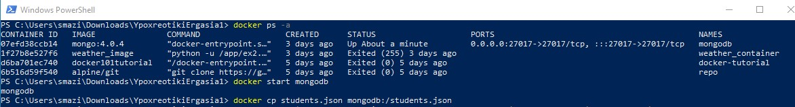
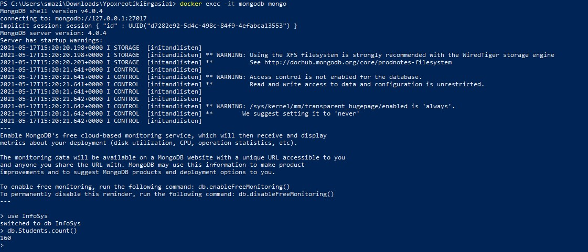

# Πληροφοριακά Συστήματα - Εργασία 1

## 0. Σύδεση με τη βάση InfoSys και εισαγωγή του αρχείου students.json στο collection Students της ΒΔ InfoSYs

  Θα ξεκινήσουμε το image της mongodb σε docker container και στη συνέχεια θα αντιγράψουμε τα data στο container
   
  
  
  Κάνουμε import τα δεδομένα του students.json στο collection της βάσης InfoSys με την παρακάτω εντολή (Εδώ βγαίνει error επειδή υπάρχουν ήδη μέσα απο προηγούμενη άσκηση)
  
  docker exec -it mongodb mongoimport --db=InfoSys --collection=Students --file=students.json
  
  
   
  Για να σιγουρευτούμε ότι τα αρχεία βρίσκονται μέσα στο collection που θέλουμε, θα μπούμε στο mongoshell και θα εκτελέσουμε την εντολή db.Students.count()
  
  
  
 ## 1. Ερώτημα 1
  
  #### username_from_request = data['username']
  Δημιούργησα μια μεταβλητή με όνομα username_from_request στην οποία θα αποθηκεύεται το username που λαμβάνουμε από τον χρήστη. 
  
  #### users = list(students.find({'username': username_from_request }))
  Δημιούργησα μια μεταβλητή με όνομα users. Σε αυτήν θα αποθηκεύεται το αποτέλεσμα της find(), αν υπάρχει ήδη χρήστης με το ίδιο username. Σε διαφορετική περίπτωση η λίστα θα παραμένει άδεια. Εδώ πρέπει το αποτέλεσμα να μετατραπεί σε lιστα με την list(), επειδή η collection.find() μας επιστρέφει τον cursor του αντικειμένου. Το όρισμα {'username': username_from_request } ψάχνει μέσα στο collection για αρχεία με το username που έχουμε λάβει από τον χρήστη.
  
  #### if not users:
  Αν η λίστα μας είναι κενή τότε δεν υπάρχει κάποιος με αυτό το username και εκτελείται η παρακάτω εντολή. Αλλιώς αν η λίστα μας περιέχει το αρχείο που βρήκε η find() με το ίδιο username, δεν θα προστεθεί ο χρήστης, και θα εμπφανιστεί μήνυμα αποτυχίας.
    
  ####  Users.insert_one({'username': username_from_request ,'password': data['password']})
  Εισάγει τον χρήστη με το username και το password του στο collection με όνομα Users, το οποίο δημιουργείται αυτόματα με αυτή την εντολή.
  
  #### return Response(data['username'] + " was added to the MongoDB",status=200, mimetype='application/json')
  Προστέθηκε το status=200 για να δηλωθεί ότι το request εκτελέστηκε με επιτυχία.
  
  #### return Response("A user with the given username already exists",status=500, mimetype='application/json')
  Προστέθηκε το status=500 για να δηλωθεί ότι το request δεν εκτελέστηκε με επιτυχία.
  
  ## 2. Ερώτημα 2 
  
  #### if (users.find({'username': data['username']}).count() != 0) and (users.find({'password': data['password']}).count() != 0)
  Ελέγχει αν υπάρχει user με αυτόν τον συνδυασμό username και password
  
  #### user_uuid = create_session(data['username']
  Αν υπάρχει, καλεί την συνάρτηση create_session με είσοδο το username του χρήστη και δημιουργεί το uuid
  
  #### res = {"uuid": user_uuid, "username": data['username']}
  Αποθηκεύει το uuid και το username σε ένα dictionary
  
  #### return Response(json.dumps(res), status=200, mimetype='application/json')
  Το οποίο περνάει από την jdon.dumps για να γίνει string και να εμφανιστεί στον χρήστη. Εδώ προστέθηκε το status 200 για να δηλώσει την επιτυχή αυθεντικοποίηση
  
  #### return Response("Wrong username or password.", status=400, mimetype='application/json')
  Σε περίπτωση ανεπιτυχούς αυθεντοκοποίησης, γυρίζει status 400
  
  ## 3. Ερώτημα 3
  
  #### uuid = request.headers.get('authorization')
  ####  if not is_session_valid(uuid):
  ####      return Response("User is not authenticated", status=401, mimetype='application/json')
  Ο χρήστης δίνει στα headers το uuid που έχει δημιουργηθεί στο προηγούμενο ερώτημα. Καλείται η is_session_valid με είσοδο το uuid του χρήστη και εαν δεν επιστρέψει κάτι, σημαίνει ότι ο χρήστης δεν έχει αυθεντικοποιηθεί και εμφανίζεται μήνυμα λάθους. Διαφορετικά συνεχίζει.
  
  #### student = students.find_one({'email': data['email']}, {'_id': 0}
  Ψάχνει για τον φοιτητή με το email που έχει περάσει ο χρήστης στο body του request, και τον αποθηκεύει στην μεταβλητή student χωρίς όμως να επιστρέφει το id του, γιατί έβγαζε error η json.dumps επειδη ο τύπος του _id είναι object id.
  
  ####     if student is not None:
  ####      return Response(json.dumps(student), status=200, mimetype='application/json')
  ####  else:
  ####      return Response("Student not found", status=400, mimetype='application/json')
  Αν η μεταβλητή student δεν είναι κενή, τότε επιστρέφει τον φοιτητή. Αν είναι κενή, τότε σημαίνει ότι δεν έχει βρεθέι φοιτητής και επιστρέφει μήνυμα λάθους.
  
  ### 4. Ερώτημα 4 
  
  Η αυθεντικοποίηση γίνεται με τον ίδιο τρόπο.
  
  #### students_thirty = list(students.find({'yearOfBirth': {"$eq": 1991}}, {'_id': 0}))
  Ονόμασα τη λίστα students_thirty γιατι το students εβγαζε error λόγω του ότι και το collection εχει το ίδιο όνομα. Εδώ βρίσκει όλους τους φοιτητές που είναι γεννημένοι το 1991, δλαδή είναι 30 χρονών και τους αποθηκεύει σε λίστα.
  
 ####   if students_thirty:
 ####       return Response(json.dumps(students_thirty), status=200, mimetype='application/json')
 ####   else:
 ####       return Response("Students not found", status=400, mimetype='application/json')
 Αν η λίστα δεν είναι κενή, την επιστρέφει στον χρήστη. Αν είναι κενή εμφανίζει μήνυμα λάθους.
  
  ### 5. Ερώτημα 5 
  
  Η αυθεντικοποίηση γίνεται με τον ίδιο τρόπο.
  
  #### students_thirty = list(students.find({'yearOfBirth': {"$lte": 1991}}, {'_id': 0}))
  Με τον ίδιο ακριβώς τρόπο όπως στο προηγούμενο ερώτημα με τη διαφορά ότι ψάχνει για φοιτητές που η χρονιά γέννησής τους είναι μικρότερη ή ίση με το 1991.
  
  ### 6. Ερώτημα 6
  
  Η αυθεντικοποίηση γίνεται με τον ίδιο τρόπο.
  
  #### if (students.find_one({'email': data['email']}) is None) or (len(students.find_one({"email": data['email']}, {'_id': 0, 'address': 1})) == 0)
  Ελέγχει αν δεν υπάρχει φοιτητής με το email που έχουμε δώσει ή αν δεν έχει δηλώσει διεύθυνση κατοινίας, δηλαδή το key addresss είναι κενό. Σε αυτήν την περίπτωση, εμφανίζει μήνυμα λάθους.
  
  #### student = students.find_one({'email': data['email']}, {'_id': 0, 'name': 1, 'address.street': 1, 'address.postcode': 1})
  Διαφορετικά, αποθηκεύει στην μεταβλητή students το dictionary που περιέχει το ονομα και τη διεύεθυνση του φοιτητή.
  
  ### 7. Ερώτημα 7
  
  Η αυθεντικοποίηση γίνεται με τον ίδιο τρόπο.
  
  #### if students.find_one({'email': data['email']})
  Ψάχνει τον φοιτητή με βάση το email του και αν τον βρει 
  
  #### student = students.find_one({'email': data['email']})
  Αποθηκεύει τα δεδομένα του στην μεταβλήτη student η οποία είναι dictionary αφού η find_one επιστρέφει dictionary.
  
  #### msg = (str(student['name']), " was deleted")
  Το μήνυμα που θα εμφανιστεί μετά την ολοκλήρωση της διαγραφής του φοιτητή.
  
  #### students.delete_one({'email': data['email']})
  Διαγράφει τον φοιτητή με βάση το email που έχουμε εισάγει
  
  #### msg = "Student was not found"
  Διαφορετικά, αν δεν βρει τον φοιτητή, εμφανίζει μήνυμα αποτυχίας.
  
  ### 8. Ερώτημα 8
  
  Η αυθεντικοποίηση γίνεται με τον ίδιο τρόπο.
  
  
  ####     if students.find_one({'email': data['email']}):
  ####      student = students.find_one({'email': data['email']})
  Ψάχνει να βρει τον φοιτητή με βάση το email που δώσαμε. Αν τον βρει, αποθηκεύει τα δεδομάνα του στην μεταβλητή student.
  
  #### students.update_one({'email': data['email']}, {"$set": {"courses": data['courses']}})
  Προσθέτει στα δεδομένα του φοιτητή τη λίστα με dictionaries που έχουμε δώσει ως είσοδο. Ο τελεστής $set δημιουργεί το key αν δεν υπάρχει ήδη. Αν υπήρχε το key, θα το έκανε update με τα νέα δεδομένα που θα είχαμε δώσει. 
  
  #### msg = ("Courses were added to ", str(student['name']))
  Το μήμυμα που θα επιστραφεί σε περίπτωση επιτυχίας.
  
  Σε διαφορετική περίπτωση, δηλαδή αν δεν βρεθεί ο φοιτητής, θα εμφανιστεί το παρακάτω μήνυμα.
  #### msg = "Student was not found"
  
   ### 9. Ερώτημα 9
   
   Η αυθεντικοποίηση γίνεται με τον ίδιο τρόπο.
   
   #### student_search = students.find_one({'email': data['email']}, {'_id': 0}
   Αρχικά ψάχνει για τον φοιτητή μέσω email και μας επιστρέφει τα δεδομένα του στην μεταβλητή student_search χωρίς το _id
   
   #### if (len(student_search) > 0) and (len(students.find_one({"email": data['email']}, {'_id': 0, 'courses': 1})) > 0)
   Ελέγχει αν το μήκος του student_search είναι μεγαλύτερο από το 0 (δηλαδή έχει επιστρέψει κάποιον φοιτητή/ άρα υπάρχει φοιτητής με αυτό το email) και αν το μήκος του students.find_one({"email": data['email']}, {'_id': 0, 'courses': 1}) είναι μεγαλύτερο από το 0 (δηλαδή ο φοιτητής με αυτό το email εχει μα΄θήματα καταχωρημένα στα δεδομένα του)
   
   #### courses = student_search['courses']
   Αν βρεθεί φοιτητής και έχει και καταχωρημένα μαθήματα, τα αποθηκέυει σε μια μεταβλητή courses. 
   
   #### failed = list(filter(failed_courses, courses))
   Αρχικά έφτιαξα τη συνάρτηση failed_courses που παίρνει ως είσοδο το κάθε course και αν ο βαθμός είναι μικρότερος του 5, επιστρέφει True.
  Έπειτα χρησιμοποίησα την filter και έδωσα ως είσοδο την failed_courses και τα courses του φοιτητή για να τσεκάρει όλα τα courses του. Αν ο βαθμός κάποιου course ηταν μικρότερος του 5, θα προσθέτει αυτό το course στη λίστα με όνομα failed.
  
   #### if len(failed) > 0
   Αν το μήκος του failed είναι μεγαλύτερο του 0, σημαίνει ότι υπάρχουν μαθήματα που δεν έχει περάσει ο φοιτητής, άρα εμφανίζει μήνυμα λάθους. 
   
   #### student = []
   ####         for item in range(len(courses)):
   ####            student.append(courses[item])
   
   Διαφορετικά, φτιάχνει μια λίστα student (το έκανα λίστα για να μπορώ να κάνω append/ είχα σκοπό να το μετατρέψω σε dictionary αλλά δεν τα κατάφερα), και για κάθε item μέσα στη λίστα courses(το κάθε item είναι της μορφής {'course 1': 10}), to κάνει append στην student. Άρα επιστρέφει τα courses με τα ονόματα τους και τους βαθμούς που είχε εισάγει ο χρήστης στο προηγούμενο ερώτημα, σε περίπτωση που ο φοιτητής έχει περάσει τα μαθήματα. 
   
   ####  msg = "Student or courses not found"
   Αν δεν βρει τον φοιτητή μέσω του email του ή αν δεν έχουν καταχωρηθεί μαθήματα στον χρήστη επιστρέφει μήνυμα λάθους. 
   
   
   
   
  
